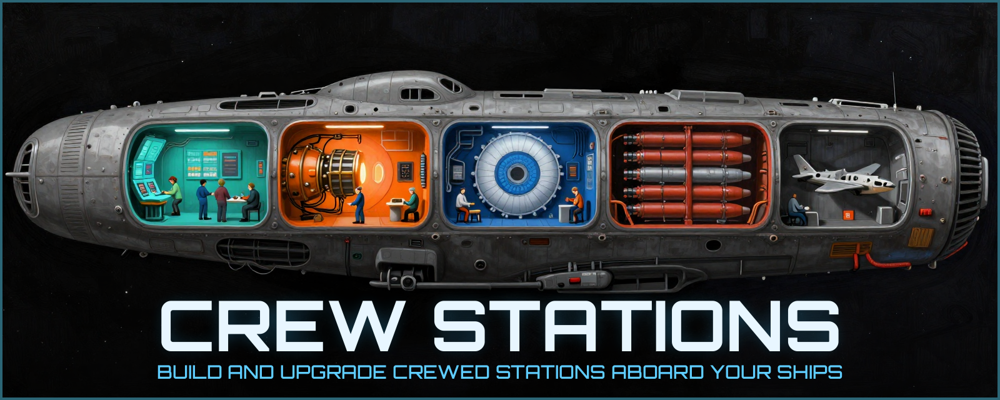

# Crew Stations

*Work in progress, for Starsector 0.98a.*

## Install

1. Download the zip from the [Releases](https://github.com/PaulRouss3l/crew_stations/releases) page.
2. Extract it into `Starsector/mods/` (you get `mods/crew-stations/`).
3. Enable **Crew Stations** in the launcher.

## Reporting bugs

Please attach your `starsector.log`; the mod's lines start with `[CrewStations]`.

## Development

See [`docs/DEVELOPMENT.md`](docs/DEVELOPMENT.md).

## AI disclosure

Some or all assets and code in this mod were created using AI tools:

- **Code:** Claude Opus 5.5 (Anthropic), through Claude Code. It wrote most of the Java code, the build and
  art tooling, and the design and API documentation. Every change goes through a human review before it is
  merged.
- **Art:** the ten Station illustrations, the Crew Stations hullmod icon and the forum banner
  (`docs/assets/banner.png`) were made with Z-Image Turbo (Alibaba's Tongyi Lab), an open image model run
  locally in ComfyUI. Prompts and the pipeline: [`docs/ART.md`](docs/ART.md). The banner title uses the
  Orbitron font (SIL Open Font License).

## License

MIT, see [LICENSE](LICENSE).
